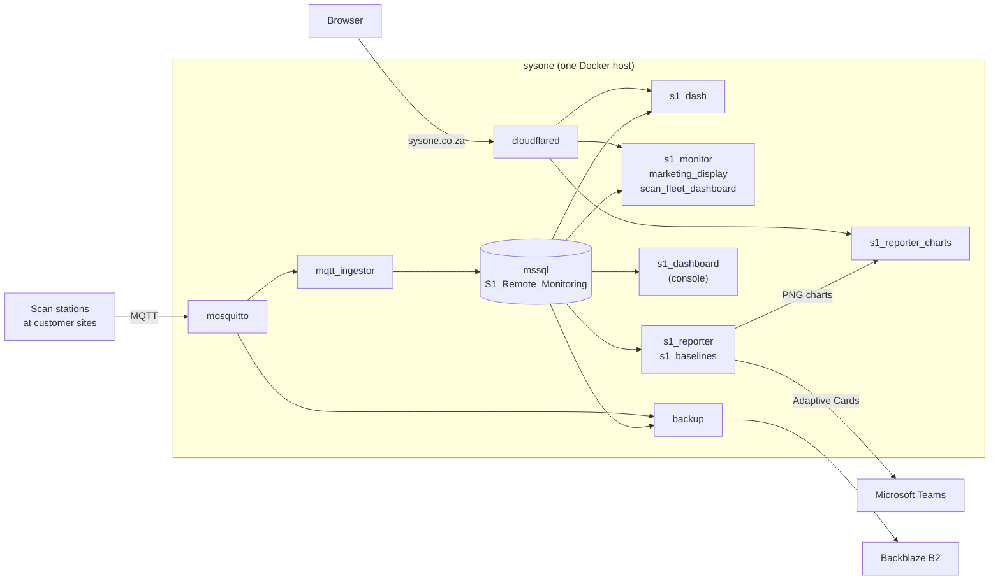
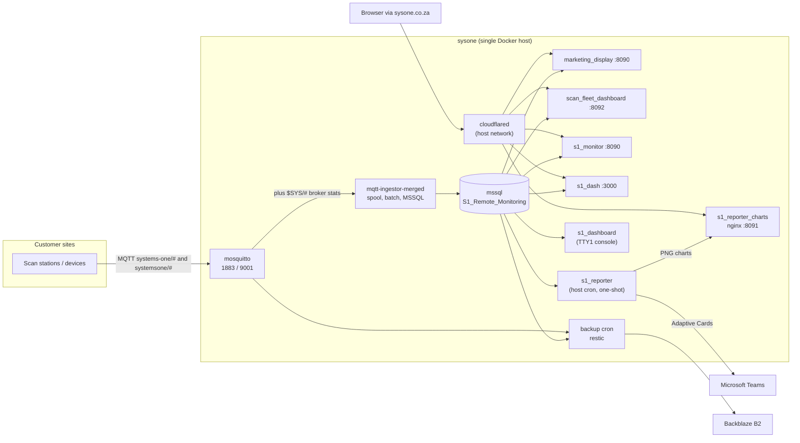

<div align="center">

<h1>Systems-One-Server</h1>

<p>
The server behind Systems One remote monitoring. Scan stations at customer sites report in,<br>
and this repository builds the one host that stores their data and turns it into dashboards,<br>
alerts and reports for Systems One staff and customer logins.
</p>

<p align="center">
  <picture>
    <source media="(prefers-color-scheme: dark)" srcset="docs/assets/systems-one-dark.png">
    
  </picture>
</p>

<p>
<a href="#deploy">Deploy</a> ·
<a href="#documentation">Documentation</a> ·
<a href="VAULT_VARS.md">Secrets reference</a> ·
<a href="roles/backup/README.md">Backup and restore</a> ·
<a href="PRODUCT.md">Product context</a>
</p>

</div>

## Contents

- [What it does](#what-it-does)
- [What the system can do](#what-the-system-can-do)
- [How it fits together](#how-it-fits-together)
- [Status](#status)
- [Get started](#get-started)
- [Deploy](#deploy)
- [Documentation](#documentation)
- [Repository layout](#repository-layout)
- [Reference](#reference)

## What it does

Scan stations and other devices at customer sites publish telemetry over MQTT. This
repository is the Ansible code that installs and configures everything on the single
production server (`sysone`, also called `s1_server`) that receives that telemetry, stores
it in SQL Server and shows it to people. Every service is a Docker container deployed by one
Ansible role.

- Staff see fleet health, throughput and scan quality on web dashboards and on the server's
  own console screen.
- Customers sign in to a dashboard that shows only their own sites.
- Microsoft Teams receives alerts and scheduled reports.
- The server is reached from the internet through a Cloudflare Tunnel on `sysone.co.za`.
- There is no packaged release. A deploy is an Ansible run on the server, started by hand or
  from GitHub Actions.

## What the system can do

"Tested in CI" below means the role has unit tests that run in
[`.github/workflows/ci.yml`](.github/workflows/ci.yml). The last CI run on `master`
(26 November 2026) passed. Test counts are `def test_` functions counted in the source, not
a test-runner total.

### Data collection and storage

In the production play. The ingestor is tested in CI; the broker and database roles have no
tests of their own.

| Area | Capability |
|---|---|
| MQTT broker (`mqtt`) | Mosquitto 2 on ports 1883 (TCP) and 9001 (WebSockets), with persistence and password-only access. |
| Ingest (`mqtt_ingestor`) | One process subscribed to `systems-one/#`, `systemsone/#` and `$SYS/#`. Writes device telemetry and broker statistics to SQL Server. |
| Durability | Messages pass through a SQLite spool (1 GiB cap, drops oldest when full) and a batched writer that retries with backoff. Messages that fail every retry go to a dead-letter table. |
| Filtering | Optional allowlist of customers and locations. Empty means allow all. |
| Ingest health | `/health` endpoint and Prometheus metrics. |
| Database (`mssql`) | SQL Server 2022 container. Creates the `S1_Remote_Monitoring` database, the application login and the schema. |

### Dashboards

All four web dashboards and the console screen are in the production play. `s1_monitor`,
`s1_dash` (role files only) and `s1_dashboard` are tested in CI. `scan_fleet_dashboard` has
tests that CI does not run. `marketing_display` has no tests.

| Area | Capability |
|---|---|
| Customer and operations dashboard (`s1_dash`) | Public at `dash.sysone.co.za`. Per-login access: admin, internal viewer, or viewer limited to named customers. The application is built in a separate repository (`Systems-One-Dash`); this repository only pulls and configures its image. |
| Fault diagnosis site (`s1_monitor`) | Fleet, Device and Trends views with charts, and a host-health snapshot every 15 minutes. Written to replace the two dashboards below. |
| Status page (`marketing_display`) | "S1 Remote Monitoring" status page with a history view. Read-only. |
| Fleet API (`scan_fleet_dashboard`) | JSON API for customers, machines, performance and throughput (KPIs, intraday, per machine), with per-customer thresholds and optional per-user customer scoping. |
| Console screen (`s1_dashboard`) | Status screen on the server's physical console (TTY1): scan totals, host metrics, Docker health and a problems-only log pane. |

### Alerts and reports

In the production play and tested in CI.

| Area | Capability |
|---|---|
| Teams alerts (`s1_reporter`) | Device status sync every 20 minutes; alert check every 20 minutes on weekdays. |
| Teams reports (`s1_reporter`) | Daily report at 06:00 on weekdays, monthly report at 06:30 on the 1st, stale-device digest at 07:00 on Mondays. Times are host-local. |
| Report charts | Chart images are served by an nginx container and published as `charts.sysone.co.za`. |
| Alert thresholds (`s1_baselines`) | Recomputes per-device warn and bad thresholds from 60 days of statistics every Sunday at 02:00, with a dry-run mode to preview. |

### Delivery and operations

| Area | Capability | State |
|---|---|---|
| Host setup (`docker`) | Installs Docker Engine and the Compose plugin and creates the shared `infra` network. | Tested in CI with Molecule. |
| Internet access (`cloudflared`) | Cloudflare Tunnel client. Web UIs bind to loopback and are reached only through the tunnel. | In the production play, no tests. |
| CI | yamllint, unit tests, ansible-lint (warning only), playbook syntax check, Molecule. | Running and passing. |
| Deploy workflow | Manual GitHub Actions run on a self-hosted runner on the server. Refuses to deploy over uncommitted changes, can be limited to one role, tags each deploy. | Written. See [Status](#status). |
| Rollback workflow | Checks out an earlier `deploy-*` tag and re-runs the play. | Written. See [Status](#status). |
| Offsite backup (`backup`) | Nightly restic backup of the database and the Mosquitto volume to Backblaze B2 (7 daily, 4 weekly, 6 monthly), and a gate that stops a deploy when the last good backup is too old. | Written, switched off in the repository configuration, no tests. |
| Label printing (`printer_relay`) | TCP relay so PPNAM Station 1 can print to an office label printer over Tailscale. Refuses connections while the printer is off. | Enabled for production, tested in CI. |

## How it fits together



| Part | What it does | Folder |
|---|---|---|
| Plays and inventories | Decide which roles run on which host. `site.yml` imports `webservers.yml` and `dbservers.yml`; both target the same machine. | [repository root](#repository-layout) |
| `docker` | Installs Docker and creates the shared network. | [`roles/docker`](roles/docker) |
| `cloudflared` | Cloudflare Tunnel client. | [`roles/cloudflared`](roles/cloudflared) |
| `mqtt` | Mosquitto broker. | [`roles/mqtt`](roles/mqtt) |
| `mqtt_ingestor` | Moves MQTT messages into SQL Server. | [`roles/mqtt_ingestor`](roles/mqtt_ingestor) |
| `mssql` | SQL Server and the database schema. | [`roles/mssql`](roles/mssql) |
| `s1_dash` | Pulls and configures the public dashboard image and its logins. | [`roles/s1_dash`](roles/s1_dash) |
| `s1_monitor` | Fault diagnosis site. | [`roles/s1_monitor`](roles/s1_monitor) |
| `marketing_display` | Status page. | [`roles/marketing_display`](roles/marketing_display) |
| `scan_fleet_dashboard` | Fleet dashboard API. | [`roles/scan_fleet_dashboard`](roles/scan_fleet_dashboard) |
| `s1_dashboard` | Console status screen. | [`roles/s1_dashboard`](roles/s1_dashboard) |
| `s1_reporter` | Teams alerts, reports and the chart server. | [`roles/s1_reporter`](roles/s1_reporter) |
| `s1_baselines` | Weekly alert-threshold recompute. | [`roles/s1_baselines`](roles/s1_baselines) |
| `backup` | Offsite backup and the pre-deploy backup gate. | [`roles/backup`](roles/backup) |
| `printer_relay` | Label printer relay. | [`roles/printer_relay`](roles/printer_relay) |
| `systems_one_ingest` | Retired ingestor. Not used by any play. | [`roles/systems_one_ingest`](roles/systems_one_ingest) |

All containers join one Docker network, `infra`, and reach each other by name. `cloudflared`
runs on the host network in production, so anything served through the tunnel must publish a
loopback port. Ports, tables and logins are listed in the [Reference](#reference).

## Status

Checked against the repository on 27 November 2026. This table says what the repository
contains and what CI proves. It does not say what is running on the server today.

| Part | State | Tests in the repo |
|---|---|---|
| `mqtt_ingestor` | In the production play. Tested in CI. | 37 in 8 files |
| `s1_reporter` | In the production play. Tested in CI. | 107 in 18 files |
| `s1_baselines` | In the production play. Tested in CI. | 34 in 6 files |
| `s1_monitor` | In the production play on port 8093. It has not yet replaced `marketing_display` and `scan_fleet_dashboard`, which are still deployed beside it. Tested in CI. | 90 in 19 files |
| `s1_dash` | In the production play on port 3000, pinned by `s1_dash_port`. CI tests the role's files only; the application code is not in this repository. | 16 in 1 file |
| `s1_dashboard` | In the production play. Tested in CI. | 22 in 1 file |
| `printer_relay` | Enabled for production only. Tested in CI. | 9 in 1 file |
| `scan_fleet_dashboard` | In the production play. Has tests, but CI does not run them. | 29 in 6 files |
| `marketing_display` | In the production play. No tests. | none |
| `mqtt`, `mssql`, `cloudflared` | In the plays. No tests beyond the playbook syntax check. | none |
| `docker` | In both plays. Converged and verified in a container by Molecule in CI. | Molecule |
| `backup` | Written. `backup_enabled` is `false` in `group_vars/all.yml` and neither host file turns it on, so the nightly job and the deploy gate are off as configured here. The restore runbook asks to be tested on staging first; the repository holds no record that it was. | none |
| `systems_one_ingest` | Retired, but still in the repository and still tested in CI. | 9 in 1 file |
| Deploy and Rollback workflows | Written. On 27 November 2026 GitHub listed no runs of the Deploy workflow and the remote had no `deploy-*` tags, so there is no evidence here that either has run. Both cover `webservers.yml` only. | none |
| Runner install script | [`scripts/install-github-actions-runner.sh`](scripts/install-github-actions-runner.sh) registers the runner against `Jwagener1/Systems-One-Server`. The repository now lives at `Systems-One/Systems-One-Server`. | none |
| Releases | None. No GitHub releases and no version tags. | |

Total: 353 test functions in 61 test files, of which CI runs 324.

Other known gaps are listed under [Known rough edges](#known-rough-edges) in the Reference.

## Get started

CI uses Python 3.12. The Molecule test also needs Docker.

```bash
pip install -r requirements.txt

# Check the playbooks parse. The values are placeholders; nothing is contacted.
echo "ci-placeholder" > .vault_pass
ansible-playbook site.yml --syntax-check -i production \
  -e "mssql_sa_password=test mssql_app_login_password=test mqtt_password=test cloudflare_tunnel_token=test backup_b2_account_id=test backup_b2_account_key=test backup_restic_password=test"

# Unit tests that need only the standard library
python roles/s1_dashboard/tests/test_dashboard.py
python -m unittest discover -s roles/printer_relay/tests
python -m unittest discover -s roles/systems_one_ingest/tests
```

The other test suites need extra packages. CI installs them like this:

```bash
pip install pyyaml
python -m unittest discover -s roles/s1_reporter/tests
python -m unittest discover -s roles/s1_baselines/tests

pip install -r roles/mqtt_ingestor/files/app/requirements.txt
python -m unittest discover -s roles/mqtt_ingestor/tests

pip install -r roles/s1_monitor/tests/requirements-dev.txt pyodbc==5.2.0
python -m pytest roles/s1_monitor/tests -q

pip install -r roles/s1_dash/tests/requirements-dev.txt
python -m pytest roles/s1_dash/tests -q
```

`.vault_pass` is gitignored. The real vault password is needed only to read or edit
`group_vars/vault.yml`, not for the commands above.

> [!WARNING]
> Do not run `ansible-playbook` without `--syntax-check` on your own machine. Both
> inventories use `ansible_connection: local`, so a real run configures whatever machine it
> is started on. Real runs belong on the server; see [Deploy](#deploy).

## Deploy

There is no installer and no release to download. Ansible runs on the server itself, from
the checkout at `/home/s1/Systems-One-Server`.

> [!WARNING]
> These steps change the live production server: they rebuild and restart containers that
> customers and devices are using. `dbservers.yml` touches the production database
> container.

From GitHub Actions:

1. Merge the change to `master` and wait for CI to pass.
2. Open **Actions**, choose **Deploy** and run the workflow. Leave `ref` as `master`, or
   give a branch, tag or commit. To deploy one role only, put its name in `tags`.
3. The workflow syntax-checks the ref, then the self-hosted runner on the server checks it
   out, runs `webservers.yml` and pushes a `deploy-YYYYMMDD-HHMMSS` tag. It stops if the
   checkout on the server has uncommitted changes.
4. To go back, run the **Rollback** workflow with an earlier `deploy-*` tag.

By hand, on the server:

```bash
ssh s1_server
cd /home/s1/Systems-One-Server
git fetch origin && git merge --ff-only origin/master
ansible-playbook -i production webservers.yml                        # all app roles
ansible-playbook -i production webservers.yml --tags s1_reporter     # one role
ansible-playbook -i production dbservers.yml                         # mssql and backup
```

Neither workflow runs `dbservers.yml`. Database and backup changes are always applied by
hand. More detail, including staging and the list of role tags, is under
[Deploying](#deploying) in the Reference.

## Documentation

There is no separate documentation index; this table is the index.

| I want to | Read |
|---|---|
| Understand who the product is for and how its screens should look | [PRODUCT.md](PRODUCT.md) |
| Find out which secrets the vault must hold | [VAULT_VARS.md](VAULT_VARS.md) |
| Turn offsite backup on or off, or restore after a disaster | [roles/backup/README.md](roles/backup/README.md) |
| Look up ports, containers, database tables, tunnel routes and logins | [Reference](#reference) below |
| Read why offsite backup was designed the way it was | [Design](docs/superpowers/specs/2026-08-11-offsite-backup-b2-design.md), [plan](docs/superpowers/plans/2026-08-11-offsite-backup-b2.md) |
| Read how deploy and rollback were designed | [Design](docs/superpowers/specs/2026-08-11-cicd-resilience-deploy-rollback-design.md), [plan](docs/superpowers/plans/2026-08-11-cicd-resilience-deploy-rollback.md) |
| Read how the single ingestor replaced the earlier ones | [Design](docs/superpowers/specs/2026-08-12-ingestor-consolidation-design.md), [plan](docs/superpowers/plans/2026-08-12-mqtt-ingestor-consolidation-build.md) |
| Read how Teams notifications replaced email | [Design](docs/superpowers/specs/2026-08-11-teams-notifications-design.md), [plan](docs/superpowers/plans/2026-08-11-teams-notifications.md) |
| Read the later overhaul of the reporter | [Design](docs/superpowers/specs/2026-09-09-s1-reporter-overhaul-design.md), [plan](docs/superpowers/plans/2026-09-09-s1-reporter-overhaul.md) |
| Read how alert thresholds are computed | [Design](docs/superpowers/specs/2026-09-09-s1-baselines-role-design.md), [plan](docs/superpowers/plans/2026-09-09-s1-baselines-role.md) |
| Read the design of the fault diagnosis site | [Design](docs/superpowers/specs/2026-09-09-s1-monitor-design.md), [plan](docs/superpowers/plans/2026-09-09-s1-monitor.md) |
| Read how `s1_dash` replaced Grafana | [Design](docs/superpowers/specs/2026-10-30-s1-dash-design.md), [plan](docs/superpowers/plans/2026-10-30-s1-dash.md) |
| Read the design of the console screen | [Design](docs/superpowers/specs/2026-07-20-tty1-dashboard-overhaul-design.md), [plan](docs/superpowers/plans/2026-07-20-tty1-dashboard-overhaul.md) |
| Read the plan for the fleet dashboard API | [Plan](docs/superpowers/plans/2026-07-20-scan-fleet-dashboard.md) (no separate design document) |

The design documents and plans are dated records of what was intended when they were
written. Where they differ from the code, the code is current.

## Repository layout

| Folder | What is in it |
|---|---|
| [`roles/`](roles) | One Ansible role per service: tasks, templates, defaults, and for the Python services the application code under `files/` and its tests under `tests/`. |
| [`group_vars/`](group_vars) | Settings shared by all hosts (`all.yml`), database settings (`dbservers.yml`) and the encrypted secrets (`vault.yml`). |
| [`host_vars/`](host_vars) | Per-host settings: `sysone.yml` for production, `sysone_staging.yml` for staging. |
| [`docs/superpowers/`](docs/superpowers) | Dated design documents (`specs/`) and implementation plans (`plans/`). |
| [`.github/workflows/`](.github/workflows) | `ci.yml`, `deploy.yml` and `rollback.yml`. |
| [`molecule/`](molecule) | Molecule scenarios for the `docker` role: `default` (converge and verify) and `syntax`. |
| [`scripts/`](scripts) | `install-github-actions-runner.sh`, which installs the self-hosted runner on the server. |
| [`.impeccable/`](.impeccable) | `config.json`: one ignore rule for the Impeccable design checker, tied to the brand rules in `PRODUCT.md`. |

| File in the root | What it is |
|---|---|
| [`site.yml`](site.yml) | Imports the two plays below. |
| [`webservers.yml`](webservers.yml) | Play for every application role. |
| [`dbservers.yml`](dbservers.yml) | Play for `mssql` and `backup`. |
| [`production`](production), [`staging`](staging) | Inventories for the hosts `sysone` and `sysone_staging`. |
| [`ansible.cfg`](ansible.cfg) | Ansible defaults: inventory, roles path, vault password file. |
| [`requirements.txt`](requirements.txt) | Python tools for working on the repository: Ansible, ansible-lint, yamllint, Molecule. |
| [`VAULT_VARS.md`](VAULT_VARS.md) | Every vault variable and what it is for. |
| [`PRODUCT.md`](PRODUCT.md) | Product context for user-interface work. |

## Reference

The blocks below hold the text of the previous README, unchanged. Some of it records the
state of the live server on the date it was written and could not be re-checked from the
repository. Where a block differs from the sections above, the sections above were checked
against the repository on 27 November 2026. The known differences are:

- **Architecture diagram:** shows `s1_monitor` on port 8090. Production pins it to 8093
  (`s1_monitor_port` in `host_vars/sysone.yml`); 8090 is the role default and still belongs
  to `marketing_display`.
- **Tests and CI:** CI also runs the `s1_baselines`, `s1_monitor`, `s1_dash` and
  `printer_relay` tests, and triggers on `main` as well as `master`. It does not run the
  `scan_fleet_dashboard` tests.
- **Deploying:** `printer_relay` also carries a tag in `webservers.yml`.
- **Services:** the monthly report runs at 06:30 on the 1st.
- **Repository layout:** `molecule/` holds two scenarios, `default` and `syntax`.

<details>
<summary><b>Introduction and contents of the previous README</b></summary>

Ansible repository that builds and runs the Systems One remote-monitoring platform on a
single production host (`sysone`, also known as `s1_server`). Every service is a Docker
container deployed by an Ansible role in this repo. The host manages itself (Ansible runs
on-box with `ansible_connection: local`) and is reached from the internet through a
Cloudflare Tunnel on `sysone.co.za`.

What the platform does: scan stations at customer sites publish telemetry over MQTT. The
server ingests it into SQL Server, and a set of dashboards and a Teams reporter turn it into
fleet health, throughput and scan-quality views.

- [Architecture](#architecture)
- [Host and network layout](#host-and-network-layout)
- [Services](#services)
- [Data](#data)
- [Public exposure (Cloudflare Tunnel)](#public-exposure-cloudflare-tunnel)
- [Also on the box, not managed here](#also-on-the-box-not-managed-here)
- [Repository layout](#repository-layout)
- [Deploying](#deploying)
- [Secrets](#secrets)
- [Backups](#backups)
- [Tests and CI](#tests-and-ci)
- [s1_dash](#s1_dash)
- [Known rough edges](#known-rough-edges)

</details>

<a id="architecture"></a>
<details>
<summary><b>Architecture</b></summary>



Data path in one line: **device to Mosquitto to mqtt_ingestor to SQL Server to s1_dash,
other dashboards and the reporter**.

</details>

<a id="host-and-network-layout"></a>
<details>
<summary><b>Host and network layout</b></summary>

One Ubuntu host runs everything. Two Ansible plays target it, both resolving to the same
machine in the `production` inventory:

| Play | Group | Roles (in order) |
|---|---|---|
| `webservers.yml` | `webservers` | `docker`, `cloudflared`, `mqtt`, `mqtt_ingestor`, `s1_dashboard`, `s1_reporter`, `marketing_display`, `scan_fleet_dashboard`, `s1_monitor`, `s1_dash`, `s1_baselines`, `printer_relay` (only when `printer_relay_enabled`) |
| `dbservers.yml` | `dbservers` | `docker`, `mssql`, `backup` |

`site.yml` imports both. `staging` is a second inventory with the same group layout
(`sysone_staging`).

**Docker networking.** All compose stacks join one external bridge network, `infra`
(`docker_shared_network` in `group_vars/all.yml`), so containers reach each other by name
(`mssql`, `mosquitto`). One container runs in `network_mode: host` instead:

- `cloudflared` (production only, see `host_vars/sysone.yml`). Because it is on the host
  stack it **cannot resolve container names**. Anything routed through the tunnel must
  publish a loopback port, and the Cloudflare public hostname must point at
  `localhost:<port>`.

**Host port map (production, confirmed with `docker ps` on 2026-09-09):**

| Host bind | Container | Purpose | Reachable from |
|---|---|---|---|
| `0.0.0.0:1883` | mosquitto | MQTT (TCP) | Internet / devices |
| `0.0.0.0:9001` | mosquitto | MQTT over WebSockets | Internet / devices |
| `0.0.0.0:1433` | mssql | SQL Server | LAN |
| `0.0.0.0:8084` | mqtt-ingestor-merged | ingestor `/health` (container port 8080) | LAN |
| `0.0.0.0:9111` | mqtt-ingestor-merged | Prometheus metrics (container port 9108) | LAN |
| `127.0.0.1:8090` | marketing_display | Status page (container port 8000) | Loopback / tunnel |
| `127.0.0.1:8091` | s1_reporter_charts | Report chart PNGs (nginx) | Loopback / tunnel |
| `127.0.0.1:8092` | scan_fleet_dashboard | Fleet dashboard API (container port 8000) | Loopback / tunnel |
| `127.0.0.1:8093` | s1_monitor | new status site (container port 8000), moves to 8090 at cutover | Loopback / tunnel |
| `127.0.0.1:3000` | s1_dash | public dashboard at `dash.sysone.co.za` (container port 8000) | Loopback / tunnel |
| `100.102.46.89:9100` | printer_relay (host net) | PPNAM Station 1 label jobs to the office printer 192.168.1.45:9100 | Tailscale only |

`scan_fleet_dashboard` defaults to 8091 but is pinned to 8092 in `host_vars/sysone.yml`
because 8091 is already owned by the chart server.

</details>

<a id="services"></a>
<details>
<summary><b>Services</b></summary>

Each role renders a `docker-compose.yml` under `/opt/<service>` on the host and runs
`docker compose up -d`. Application code lives in the role's `files/` directory and is
built into an image on the host.

| Role | Container | Image | Install dir | What it does |
|---|---|---|---|---|
| `docker` | none | none | none | Installs Docker Engine and the Compose plugin, creates the `infra` network, adds the deploy user to the `docker` group. |
| `cloudflared` | `cloudflared` | `cloudflare/cloudflared` | `/opt/cloudflared` | Cloudflare Tunnel client. Token from vault. Host network mode in production. |
| `mqtt` | `mosquitto` | `eclipse-mosquitto:2` | `/opt/mqtt` | MQTT broker with persistence and password auth only (no anonymous). Ports 1883 and 9001. The password file is regenerated whenever the vault credentials change. `mosquitto_max_packet_size` caps packet size. |
| `mqtt_ingestor` | `mqtt-ingestor-merged` | built `mqtt-ingestor-merged:latest` | `/opt/mqtt_ingestor` | The single ingest process. One MQTT client subscribed to `systems-one/#`, `systemsone/#` and `$SYS/#`. Device telemetry goes to `dbo.*` tables and broker stats to `broker.broker_stats`, through a SQLite spool, a batched writer, retry with backoff and a dead-letter table. Optional customer/location allowlist. Exposes `/health` and Prometheus metrics. |
| `mssql` | `mssql` | `mcr.microsoft.com/mssql/server:2022-latest` | `/opt/mssql` | SQL Server Developer edition. Creates `S1_Remote_Monitoring`, the `admin` application login and the `dbo.*` schema from `bootstrap.remote_monitoring.sql.j2`. A second bootstrap for a legacy `Systems_One` database exists but only runs when `mssql_bootstrap_enabled` is true. |
| `marketing_display` | `marketing_display` | built `marketing-display:latest` | `/opt/marketing-display` | FastAPI plus static HTML and Chart.js "S1 Remote Monitoring" status page (`/` and `history.html`). Read-only over the RM database with a 30 s cache. |
| `scan_fleet_dashboard` | `scan_fleet_dashboard` | built `scan-fleet-dashboard:latest` | `/opt/scan-fleet-dashboard` | FastAPI JSON API for the fleet dashboard: customers, machines, performance, throughput KPIs, intraday and per-machine views, per-customer thresholds and optional per-user customer scoping (`AUTH_ENABLED`). Runs side-by-side with `marketing_display` until cutover. |
| `s1_dash` | `s1_dash` | `ghcr.io/systems-one/s1-dash:<tag>` (private, pulled) | `/opt/s1-dash` | FastAPI customer and operations dashboard, public at `dash.sysone.co.za` (it replaced Grafana), built from the `Systems-One-Dash` repo. See [s1_dash](#s1_dash). Per-login access (admin, internal viewer, customer-scoped) from `/opt/s1-dash/users.json`. Reads `S1_Remote_Monitoring` as `admin`; keeps `dbo.dash_*` tables. |
| `s1_monitor` | `s1_monitor` | built `s1-monitor:latest` | `/opt/s1-monitor` | FastAPI plus static ECharts site "S1 Remote Monitoring" for fault diagnosis: Fleet, Device (summary, errors, daily figures, throughput heatmap, comparison, downloads), Trends. Records host health snapshots into `dbo.device_health_history` every 15 min. Replaces `marketing_display` and `scan_fleet_dashboard` at cutover. |
| `s1_reporter` | one-shot `reporter` via `compose run`, plus `s1_reporter_charts` | built `s1-reporter:latest`, `nginx:alpine` | `/opt/s1-reporter` | Teams alerts and reports as host-cron jobs: `sync-status` every 20 min, `check-alerts` every 20 min on weekdays, `daily` 06:00 weekdays, `monthly` on the 1st, `stale-digest` Monday 07:00. Customer capabilities and limits live in `dbo.customer_config`; per-device `reporting_enabled` and `muted_until` on `dbo.devices`. Chart PNGs served by nginx as `charts.sysone.co.za`. |
| `s1_baselines` | none (one-shot via `compose run`) | built `s1-baselines:latest` | `/opt/s1-baselines` | Recomputes `dbo.alert_thresholds` from 60 days of `device_statistics`. Host cron runs `run-baselines.sh apply` every Sunday 02:00; operators run `sudo /opt/s1-baselines/run-baselines.sh dry-run` to preview (the compose file and log are root-owned). Owns the table's DDL via `migrate`. |
| `printer_relay` | `printer_relay` | built `printer-relay:latest` | `/opt/printer-relay` | Stdlib-only Python raw TCP relay so PPNAM Station 1 can print to the office TSC ML241P (192.168.1.45:9100) over Tailscale. Station 1's printer setting is `100.102.46.89` port `9100`. Listens only while the printer accepts connections, because Station 1 treats a successful TCP connect as "Online"; when the printer is off, clients get connection refused instead of silently lost labels. Uses host networking for the same reason (docker-proxy would accept on its behalf). Only Tailscale clients (`100.64.0.0/10`) are forwarded. Enabled per host with `printer_relay_enabled`. Jobs are logged: `docker logs printer_relay`. |
| `s1_dashboard` | none (host process) | none | `/opt/s1-dashboard` | Stdlib-only Python status screen on the physical console. Configures `getty@tty1` autologin for the deploy user and launches the dashboard from `.profile`. Shows today/week/year scan totals, host metrics, Docker health and a problems-only log pane. |
| `backup` | none (cron) | `restic/restic:0.17` | `/opt/backup` | Nightly 02:30 restic backup of the RM database (`.bak`) and the Mosquitto volume to Backblaze B2. A pre-deploy gate in both plays refuses to run if the last successful backup is older than `backup_gate_max_age_hours`. Off by default (`backup_enabled: false`). See `roles/backup/README.md`. |
| `systems_one_ingest` | none | none | none | **Retired.** The original ingestor, superseded by `mqtt_ingestor`. Not referenced by any play. The role and its tests are still in the repo. |

Which service talks to what:

| Consumer | Reads / writes | Login used |
|---|---|---|
| `mqtt_ingestor` | writes `dbo.*`, `broker.broker_stats`, `ingest.*` | `mssql_rm_admin_login` (`admin`) |
| `marketing_display`, `scan_fleet_dashboard`, `s1_dashboard`, `s1_dash` | read `S1_Remote_Monitoring` | `admin` |
| `s1_reporter` | reads telemetry, `customer_config`, `alert_thresholds`; writes `dbo.device_status` | `admin` |
| `s1_baselines` | reads `device_statistics`, writes `alert_thresholds` | `admin` |
| `backup` | dumps `mssql`, tars the Mosquitto volume | `sa` inside the container |

</details>

<a id="data"></a>
<details>
<summary><b>Data</b></summary>

One database, `S1_Remote_Monitoring`, on the `mssql` container. The schema is created by
`roles/mssql/templates/bootstrap.remote_monitoring.sql.j2` and extended by
`roles/mqtt_ingestor/files/app/migrations/001_init_schema.sql`.

| Schema.table | Written by | Purpose |
|---|---|---|
| `dbo.devices` | ingestor | Device registry keyed by customer, location and machine name. Machine names such as `DIM1` repeat across sites, so the key is the triple. |
| `dbo.device_status` | ingestor, reporter | Latest online/offline state per device. |
| `dbo.device_application_status`, `device_os_status`, `device_uptime_status`, `device_storage_status`, `device_os_metrics` | ingestor | Latest per-device application, OS, uptime, storage and OS-metric snapshots (MERGE upserts). |
| `dbo.device_statistics` | ingestor | Append-only scan statistics per interval: items, good reads, no-dim and so on. Source for every dashboard and report. |
| `broker.broker_stats` | ingestor | Mosquitto `$SYS` snapshots. |
| `dbo.customer_config` | reporter `migrate`, edited by hand | Per-customer capabilities (dimension, weight, hand scan) and alert limits. |
| `dbo.alert_thresholds` | `s1_baselines` | Per-device warn/bad thresholds from 60-day baselines. |
| `dbo.device_health_history` | `s1_monitor` | 15-minute host health snapshots: status, app running, uptime, CPU, memory, temperature, drive usage. |
| `ingest.pipeline_state`, `ingest.telemetry_deadletter` | ingestor | Pipeline bookkeeping and messages that failed every retry. |
| `dbo.DailyStats`, `driver_log`, `ItemLog`, `TripInfo` | legacy `Systems_One` bootstrap | Older schema, only created when `mssql_bootstrap_enabled` is true. |

Persistent Docker volumes: `mssql_data`, `mosquitto_data`,
`s1_reporter_data`, `s1_reporter_charts`, and the ingestor's `spool-data` and
`settings-data`. (The retired Grafana volume `grafana_grafana_data` is kept on the host for
rollback, see [s1_dash](#s1_dash).)

</details>

<a id="public-exposure-cloudflare-tunnel"></a>
<details>
<summary><b>Public exposure (Cloudflare Tunnel)</b></summary>

Nothing except MQTT and SQL Server is published beyond
loopback. Web UIs are reached through the Cloudflare Tunnel, whose public hostnames are
configured in Cloudflare Zero Trust, not in this repo. Known routes:

| Hostname | Target on the host |
|---|---|
| `sysone.co.za` | `localhost:8090` (marketing_display) |
| `dash.sysone.co.za` | `localhost:3000` (s1_dash) |
| `charts.sysone.co.za` | `localhost:8091` (s1_reporter_charts) |
| `charts-staging.sysone.co.za` | staging equivalent |

The scan-fleet API is also loopback-bound and served the
same way. Because `cloudflared` runs on the host network, every tunnel target must be a
`localhost:<port>` address, never a container name.

</details>

<a id="also-on-the-box-not-managed-here"></a>
<details>
<summary><b>Also on the box, not managed here</b></summary>

`docker ps` on `sysone` shows containers this repo does not own. Leave them alone:

| Container(s) | What it is |
|---|---|
| `eskom-asset-management-web-1`, `eskom-asset-management-sql-1` | Separate .NET app with its own SQL Server (port 14333), different owner. |
| `ppnam-sync-sync-service-1`, `ppnam-sync-central-sql-1` | Separate sync service with its own SQL Server (port 14330). |
| `wetty` | Browser SSH terminal on `127.0.0.1:4000`, hand-deployed. Fallback shell access. |

Directories under `/home/s1` such as `mqtt-ingestor` and `broker-ingestor` are the old
hand-deployed ingestors. Their containers are no longer running; `mqtt_ingestor` replaced
both.

</details>

<details>
<summary><b>Repository layout</b></summary>

```
ansible.cfg                inventory=production, roles_path=roles, vault_password_file=.vault_pass
site.yml                   imports webservers.yml and dbservers.yml
webservers.yml             web tier play (all application roles)
dbservers.yml              db tier play (mssql and backup)
production / staging       INI inventories (sysone / sysone_staging)
group_vars/all.yml         shared network name, backup gate defaults
group_vars/dbservers.yml   RM database name and application login
group_vars/vault.yml       Ansible Vault with all secrets, loaded explicitly by each play
host_vars/sysone.yml       production host: local connection, host-network cloudflared, s1_dash users, ports
host_vars/sysone_staging.yml  staging host overrides
roles/                     one role per service (see Services)
docs/superpowers/          dated design specs and implementation plans
scripts/                   install-github-actions-runner.sh (self-hosted runner)
molecule/                  Molecule scenario for the docker role
.github/workflows/         ci.yml, deploy.yml, rollback.yml
VAULT_VARS.md              reference for every vault variable
PRODUCT.md                 product context for UI work
```

</details>

<a id="deploying"></a>
<details>
<summary><b>Deploying</b></summary>

Ansible runs **on the server**, from the checkout at `/home/s1/Systems-One-Server`. There is
no separate control node.

Manual deploy:

```bash
ssh s1_server
cd /home/s1/Systems-One-Server
git fetch origin && git merge --ff-only origin/master
ansible-playbook -i production webservers.yml                        # all app roles
ansible-playbook -i production webservers.yml --tags s1_reporter     # one role
ansible-playbook -i production dbservers.yml                         # mssql and backup
```

Roles that carry tags: `mqtt_ingestor`, `s1_reporter`, `marketing_display`,
`scan_fleet_dashboard`, `s1_monitor`, `s1_dash`, `s1_baselines`. Using `--tags` skips untagged tasks, which is why the vault-loading
and backup-gate pre-tasks are tagged `always`.

GitHub Actions (`.github/workflows`):

- **Deploy** (`workflow_dispatch`): syntax-checks the chosen ref, then a self-hosted runner
  labelled `s1-server` checks it out on the box, refuses to proceed over uncommitted local
  changes, runs `webservers.yml` (optionally scoped by role tag) and pushes a
  `deploy-YYYYMMDD-HHMMSS` git tag.
- **Rollback** (`workflow_dispatch`): checks out a previous `deploy-*` tag and re-runs
  `webservers.yml`.
- Neither workflow runs `dbservers.yml`. Database and backup changes are applied by hand.

Staging:

```bash
ansible-playbook -i staging site.yml
```

</details>

<a id="secrets"></a>
<details>
<summary><b>Secrets</b></summary>

All secrets live in `group_vars/vault.yml`, encrypted with Ansible Vault. The vault
password sits in the gitignored `.vault_pass` on each machine that runs Ansible. Every
variable is listed in `VAULT_VARS.md`, including the `vault_grafana_<login>_password` names
that are now the s1_dash login passwords. Edit with:

```bash
ansible-vault edit group_vars/vault.yml
```

Plays load the vault file explicitly in `pre_tasks` and then assert the variables they need,
so a missing secret fails early with a clear message.

</details>

<a id="backups"></a>
<details>
<summary><b>Backups</b></summary>

Nightly restic snapshots of the RM database and the Mosquitto volume go to Backblaze B2,
with 7 daily, 4 weekly and 6 monthly retention. When enabled, both plays are gated on a
recent successful backup before touching anything. Enable, disable and disaster-recovery
steps are in `roles/backup/README.md`.

</details>

<a id="tests-and-ci"></a>
<details>
<summary><b>Tests and CI</b></summary>

`ci.yml` runs on every push and pull request to `master`:

- yamllint over the repo
- unit tests for `s1_dashboard`, `s1_reporter`, `systems_one_ingest` and `mqtt_ingestor`
- `ansible-lint --profile=min site.yml` (warning only)
- `ansible-playbook site.yml --syntax-check` with placeholder secrets
- Molecule converge and verify of the `docker` role in a systemd Ubuntu container

Run tests locally:

```bash
python -m unittest discover -s roles/s1_reporter/tests
python -m unittest discover -s roles/mqtt_ingestor/tests
python -m pytest roles/scan_fleet_dashboard/tests
python -m pytest roles/s1_monitor/tests
python -m pytest roles/s1_dash/tests
python -m unittest discover -s roles/printer_relay/tests
```

</details>

<a id="s1_dash"></a>
<details>
<summary><b>s1_dash</b></summary>

`s1_dash` is the public dashboard at `https://dash.sysone.co.za`. It is a FastAPI container
(`ghcr.io/systems-one/s1-dash`, private image pulled with the `Systems-One` account) bound to
`127.0.0.1:3000` (`s1_dash_port` in `host_vars/sysone.yml`; the role default is 8094), with `SESSION_SECURE` and `TRUST_PROXY_IP` on because Cloudflare terminates
TLS in front of it. The role asserts that trust-proxy is only enabled with a loopback bind.

- **Logins** come from `s1_dash_users` in `host_vars/sysone.yml` and are rendered to
  `/opt/s1-dash/users.json`. The ten passwords are the `vault_grafana_<login>_password`
  variables; the names are historical (they began as Grafana passwords). See `VAULT_VARS.md`.
- **Data** is read-only over `S1_Remote_Monitoring` as `admin`; the app keeps its own
  `dbo.dash_*` tables.

### Cutover and rollback

Grafana was retired when `dash.sysone.co.za` moved to s1_dash. The Cloudflare public hostname
(Zero Trust, not in this repo) still points at `localhost:3000`: s1_dash took over the port
Grafana listened on, so the route was left as it was. Both cannot run at once. The
`grafana` role is gone from the repo, but the container's data is deliberately kept on the
host until the owner deletes it: the Docker volume `grafana_grafana_data` and the directory
`/opt/grafana` (compose file, provisioning, dashboard checkout).

Stop and remove the Grafana container while keeping the volume and directory (no `-v`):

```bash
cd /opt/grafana && docker compose down
```

To bring Grafana back while the volume and directory still exist:

```bash
cd /opt/s1-dash && docker compose down       # s1_dash holds port 3000; free it first
cd /opt/grafana && docker compose up -d      # listens on 127.0.0.1:3000
```

The Cloudflare route already points at `localhost:3000`, so nothing changes there. To run both,
move s1_dash to another port (`s1_dash_port`) and give it its own public hostname. The compose
file in `/opt/grafana` is the last one the retired role rendered; the role itself is in git
history before the `chore: remove the grafana role` commit. To delete Grafana for good:
`docker volume rm grafana_grafana_data && rm -rf /opt/grafana` (and remove the image).

There is no automated legacy-retirement play in this repo: retired services (Node-RED,
Grafana) are removed from the host by hand and the role is deleted.

</details>

<a id="known-rough-edges"></a>
<details>
<summary><b>Known rough edges</b></summary>

Starting points for the overhaul, all confirmed against the repo or the live host:

- `dbo.customer_config` and the device flags are edited by hand in SQL until a UI exists.
- `mssql_rm_admin_password` is plain text in `group_vars/dbservers.yml`, not in the vault.
- `roles/systems_one_ingest` is retired but still shipped and still tested in CI.
- The Deploy and Rollback workflows only cover `webservers.yml`.
- Cloudflare public hostnames are not captured anywhere in the repo, and the host-network
  `cloudflared` constraint has already caused one production 502.
- `marketing_display` and `scan_fleet_dashboard` overlap. `s1_monitor` replaces both at
  cutover.
- `ppnam-sync`, `wetty` and the Eskom app share the host but sit outside Ansible.
- The `mqtt` role ships an empty `Caddyfile.j2` that nothing uses.

</details>
